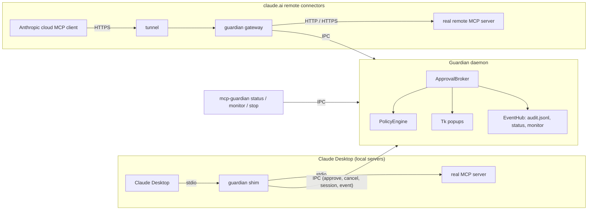
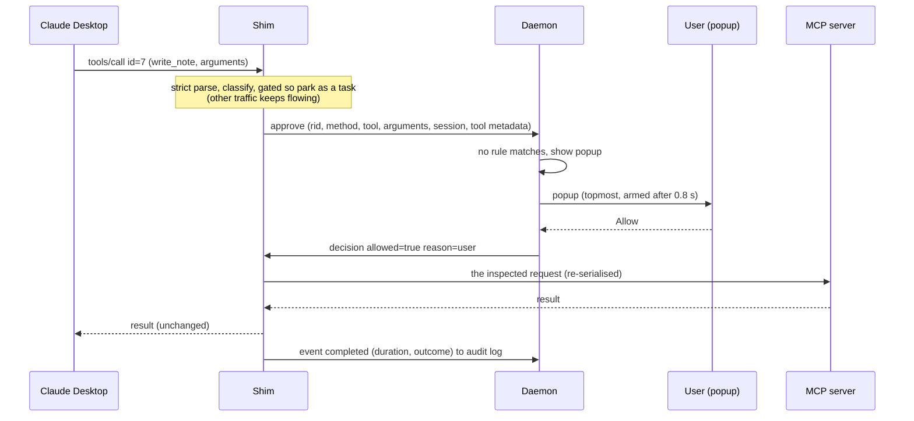
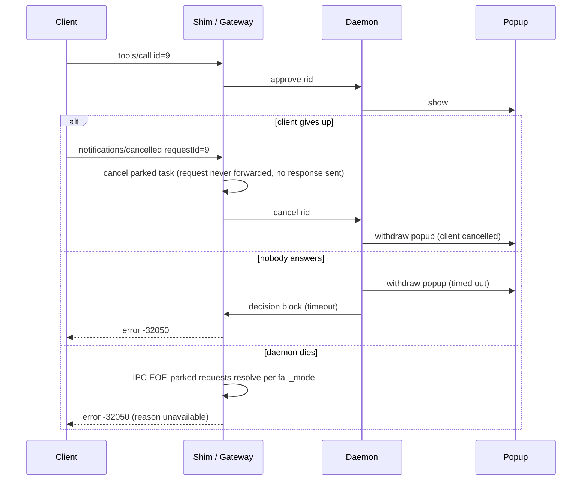

# Architecture

This document explains where MCP traffic actually flows for Claude Desktop and claude.ai, why MCP Guardian intercepts it where it does, and how the pieces work together to hold, decide and release each request reliably.

## 1. Where MCP traffic flows

| Client | Who is the MCP client? | Transport | Where can a user interpose? |
|---|---|---|---|
| Claude Desktop, local servers | The Claude Desktop app itself | stdio: the app spawns each server from `claude_desktop_config.json` and exchanges newline-delimited JSON-RPC over the child's stdin/stdout | **Between the app and the child process**, by changing which command the app launches |
| claude.ai (and Claude Desktop/mobile) remote connectors | Anthropic's cloud | Streamable HTTP (POST JSON-RPC, JSON or SSE responses) from Anthropic's infrastructure to the connector URL | **At the connector URL**: the endpoint the user registers |

Two consequences drive the design:

1. For local servers the messages never touch the network (they're pipes), so network-level monitoring can't see them. They have to be intercepted at the process boundary.
2. For claude.ai the browser never carries MCP messages; the MCP client is in Anthropic's cloud. The only place a user controls is the server endpoint, so the interceptor has to *be* the endpoint.

Both interceptors understand MCP/JSON-RPC, so they can tell a `tools/call` apart from a `ping`, hold just the sensitive requests, and answer blocked ones correctly.

## 2. Components



| Component | Role | Module |
|---|---|---|
| **Shim** | Enforcement point for stdio. Spawns the real server, relays both directions, holds gated requests. | `shim.py` |
| **Gateway** | Enforcement point for Streamable HTTP. Reverse proxy with path-secret routing, holds gated requests, streams responses. | `gateway.py` |
| **SessionTracker** | Shared protocol logic: client/server identity, tool catalogue from `tools/list`, request/response correlation, `input_required` continuations, block responses. | `interceptor.py` |
| **GuardianClient** | IPC client used by both enforcement points: lazy connect, daemon auto-start, reconnect, multiplexed approvals, fail mode. | `client.py` |
| **Daemon** | Decision point. One per user. Authenticated IPC server, session registry, CLI endpoints. | `daemon.py` |
| **ApprovalBroker** | Owns pending approvals: rules → popup → timeout; cancellation; limits; "remember" also settles waiting requests with identical arguments. | `broker.py` |
| **UI** | Tk popups (default), native macOS dialogs (no Tk), console (headless), null (blocks everything). | `ui/` |

Splitting enforcement (shim/gateway) from decision (daemon) keeps the parts that sit in the data path small and dependency-light. The shim imports only the standard library and starts quickly every time Claude launches a server. It also gives one place for policy, UI and audit across every client, and lets the network-facing gateway run in its own process.

## 3. Request lifecycle

### Allowed



### Blocked

The decision is `allowed: false`, so the shim never writes to the server and answers Claude itself:

```json
{"jsonrpc":"2.0","id":7,"error":{"code":-32050,
 "message":"MCP Guardian blocked this tools/call request: the user denied it. The action was NOT executed. Do not retry it unless the user explicitly asks you to.",
 "data":{"guardian":"mcp-guardian","reason":"user","detail":"blocked by the user (Block button)"}}}
```

`-32050` is in JSON-RPC's implementation-defined server-error range. A JSON-RPC error (rather than a tool result) is the honest answer, because the tool never ran. `block_style = "result"` switches to an `isError: true` tool result for clients that present those better.

### Cancelled, timed out or failed



For HTTP, a client that disconnects causes aiohttp to cancel the request handler (`handler_cancellation=True`), and that cancellation follows the same path.

## 4. Concurrency model

- **Shim:** one asyncio loop. A thread reads stdin with `os.read` (portable, and it avoids CPython's buffered-reader lock aborting the interpreter at exit), and another thread writes stdout from a queue, so lines never interleave. Every gated request becomes its own task stored in `held[id]`, so N requests can wait at once while `tools/list`, pings, progress notifications and server→client messages keep flowing. Allowed requests are written when their decision arrives, in decision order. JSON-RPC and MCP don't require response ordering.
- **IPC:** a single connection per interceptor carries any number of approvals, each tagged with a random `rid`. Responses resolve futures in a dict.
- **Daemon:** each approval is a task. `ApprovalBroker.evaluate` awaits a future that the UI resolves from the Tk thread via `loop.call_soon_threadsafe`. Cancelling the task (client cancel, interceptor disconnect, shutdown) withdraws the popup in a `finally`-style path.
- **UI:** Tk must own the main thread on macOS, so the daemon runs asyncio on a worker thread. Asyncio→Tk goes through a `queue.Queue` drained every 50 ms; Tk→asyncio goes through the resolver. Each request gets its own `Toplevel`, cascaded and badged "n of m pending", and they can be answered in any order. When the user ticks "remember", the new rule settles waiting requests with the same server, tool **and arguments**. A waiting `run_shell_command("rm -rf ~")` is never approved as a side effect of approving `run_shell_command("ls")`; later calls follow the remembered rule.
- **Gateway sessions:** state (identity, in-flight ids, held requests, continuations) is kept per `Mcp-Session-Id`. Requests without one, such as `initialize` or stateless servers, get a fresh tracker; it is registered under the id the upstream assigns and never re-keyed, so two conversations never share identity, request ids or cancellations. Only the tool catalogue (descriptions and annotations shown in popups) is shared per upstream.
- **Holding HTTP requests:** if the client accepts SSE (MCP clients must), the gateway answers right away with a `text/event-stream` response and sends `: keep-alive` comments every 15 s while the user decides, then writes the blocked answer or the upstream's result into the same stream. Tunnels and CDNs that drop requests with no bytes for ~100 s (Cloudflare: 524) therefore don't cut off slow approvals. Lifecycle requests (`initialize`, `server/discover`), if gated, wait without streaming, because their response headers (`Mcp-Session-Id`) must come from the upstream.

## 5. Protocol coverage

| Feature | Handling |
|---|---|
| `initialize` handshake (2024-11-05 → 2025-11-25) | `clientInfo`/`protocolVersion` captured from the request, `serverInfo` from the response. |
| Stateless envelope (2026-07-28) | Identity from `params._meta["io.modelcontextprotocol/clientInfo"]` on every request; `server/discover` result captured. |
| `input_required` multi-round calls (2026-07-28) | When an approved `tools/call` returns `resultType: "input_required"`, its follow-up round is let through once without a second popup, but only if the tool name and arguments are identical and the server's `requestState` is echoed. A reused `requestState` can't carry approval over to a different call. |
| Batches (2025-03-26) | Each element is classified and gated individually. |
| Cancellation | `notifications/cancelled` for a parked request is consumed by Guardian; for forwarded requests it is passed on. |
| Server→client requests (sampling, roots, elicitation) and their responses | Passed through untouched. |
| Tool annotations | `readOnlyHint`/`destructiveHint` drive the popup's risk colour, using the spec defaults when they're absent. They're labelled as server-declared hints. |

Default gated methods: `tools/call`, `resources/read`, `prompts/get`, the requests that make a server act or disclose data. `initialize`, listing, `ping`, `completion/complete` and notifications aren't gated by default (gating them would mean constant popups for no security benefit), but every request is still recorded. Anything can be added to `gated_methods`; for example, adding `initialize` turns every new connection into an approval.

## 6. Hardening details

- **Parse strictly, forward what was inspected.** Duplicate keys (`{"method":"tools/list","method":"tools/call"}`), `NaN`/`Infinity`, numbers that overflow to infinity (`1e400`), lone surrogates, invalid UTF-8, null/float/bool ids and non-`2.0` messages are rejected with JSON-RPC errors and never forwarded. Forwarding the re-serialised object guarantees the server receives exactly what was evaluated. Method matching for gating is case- and whitespace-insensitive, and a gated method sent as a notification (no `id`, so it can't be answered) is dropped rather than forwarded to a server that might execute it anyway. Any internal error while gating a request produces a fail-closed error reply, never a hang or a pass-through.
- **Fail closed** when the daemon is unreachable, the connection drops mid-wait, the UI can't open a window, the daemon hits an internal error, or no UI exists at all. `fail_mode = "open"` is available but opt-in.
- **IPC mutual authentication.** A random 256-bit token in `auth.token` (0600). The daemon proves knowledge of the token as well, so on Windows (loopback TCP) a process squatting the port can't impersonate the daemon. On POSIX the socket is 0600 inside a 0700 directory.
- **Gateway exposure.** Binds to 127.0.0.1 by default; the public tunnel URL is a capability URL (`/mcp/<upstream>/<secret>`, compared in constant time); body size limits; only MCP-relevant headers are forwarded (no cookies); upstream credentials can be injected by the gateway; TLS verification uses the system store plus `certifi` (python.org macOS builds ship without root certificates).
- **UI safety.** Arming delay, no keyboard shortcut for Allow, Esc/close mean Block, and a "Remember" checkbox that's off by default and lasts only until restart.
- **Config rewrite safety.** A timestamped 0600 backup is written before every change, followed by an atomic replace. Unknown keys are preserved and nothing that Claude Desktop might reject is added. The original command is recoverable from the args, so `uninstall` is lossless, and re-running `install` is idempotent.

## 7. Alternatives considered

| Approach | Why it was rejected |
|---|---|
| Packet capture / pcap | stdio MCP never touches the network; remote MCP from claude.ai doesn't touch the user's machine; and TLS would hide content anyway. It also can't *hold* a request. |
| TLS-intercepting proxy (mitmproxy) on Claude Desktop | Claude Desktop's local MCP is stdio, not HTTP. Remote connectors are called from Anthropic's cloud, not from the desktop. It would also require trusting a custom CA system-wide. |
| Patching or injecting into the Electron app | Fragile across updates, breaks code signing, and is out of bounds for a security tool. |
| ptrace/DTrace on the server's pipes | Needs elevated privileges (and SIP changes on macOS); observing isn't enough to block safely. |
| Browser extension on claude.ai | Can only watch the UI; claude.ai executes connector calls server-side (and "always allow" tools never ask the browser), so it can't block reliably. It would also depend on private, changing APIs. |
| Re-implementing each server as an MCP server/client pair using an SDK | Loses fidelity (unknown methods, capabilities, new protocol revisions). The transparent JSON-RPC proxy passes through everything it doesn't need to understand. |

Proxying at the protocol layer on the two real transport paths is the only approach that can see *and* hold every request without privileges, works with any MCP server, and doesn't depend on Claude internals.

## 8. IPC protocol reference

One JSON object per line.

```
daemon → client  {"type":"challenge","v":1,"nonce":Ns}
client → daemon  {"type":"hello","v":1,"nonce":Nc,"mac":HMAC(token,"client|Ns|Nc"),"role":"shim|gateway|cli",...}
daemon → client  {"type":"welcome","mac":HMAC(token,"daemon|Nc|Ns"),"settings":{gated_methods, block_style, ...}}

shim/gateway → daemon
  {"type":"session","session":{SessionInfo}}              # announce/update (re-sent after reconnect)
  {"type":"approve","rid":R,"request":{ApprovalRequest}}  # → {"type":"decision","rid":R,"decision":{allowed, reason, detail}}
  {"type":"cancel","rid":R}
  {"type":"event","event":"completed","fields":{...}}     # audit only
  {"type":"session_end","session_id":S}

cli → daemon (hello carries "command")
  status | subscribe (stream of {"type":"event"}) | shutdown | forget
```

## 9. Files

```
~/.mcp-guardian/                   (0700; MCP_GUARDIAN_HOME overrides)
  config.toml                      optional settings
  auth.token                       IPC secret (0600)
  guardian.sock / guardian.port    IPC endpoint (POSIX / Windows)
  daemon.lock, daemon.pid          single instance
  gateway.secret                   connector URL secret (0600)
  logs/audit.jsonl                 audit trail (0600, rotated at 10 MB)
  logs/daemon.log                  daemon log when started in the background
  backups/                         claude_desktop_config.json backups (0600)
```
